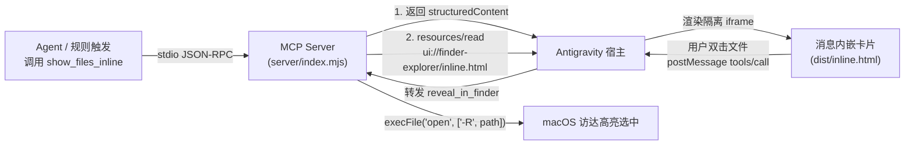

# Finder 浏览器 (`finder-explorer`)

一个零外部依赖的 **Antigravity MCP App 插件**，让你可以在 Antigravity 的**聊天消息流**和**侧边栏**中直接双击文件，调用 macOS 访达（`open -R`）弹出并高亮定位到具体文件。

---

## 一、它解决了什么问题？

在 macOS 上使用 Antigravity（反重力）时，常见 4 个文件定位痛点：

1. **聊天消息里的文件胶囊双击没用**：Antigravity 对话气泡里的 `file://` 胶囊由客户端原生渲染，双击只会触发选中复制（`Copy`）或应用内预览，无法直接弹出 macOS 访达，且插件接口不允许覆盖原生消息文本的点击事件。
2. **产出目录（`.gemini`）默认隐藏**：Antigravity 的 Artifact / 对话产物默认存放在 `~/.gemini/antigravity/brain/<会话ID>/` 下，macOS 访达默认隐藏 `.` 开头的目录，手动找路径非常麻烦。
3. **文件关联或中文路径不便**：`.md` 等文档双击常提示缺少默认应用，或者带中文/空格的路径在链接跳转时容易出错。
4. **缺少一站式“看产出 + 定位文件”入口**：需要在终端和访达之间反复复制路径执行 `open -R`。

**本插件的解法**：
* 用 **MCP App 内嵌卡片（`show_files_inline`）** 把交互式文件列表直接放进对话消息流；
* 用 **MCP App 侧边栏浏览器（`open_finder_browser`）** 提供工作区、近期项目与 `~/.gemini/antigravity/brain` 的统一浏览视图；
* 在卡片/面板内**双击任意文件**，由后端 MCP Server 安全执行 `execFile("open", ["-R", targetPath])`，精准弹出访达并选中文件。

---

## 二、卡片的工作原理

整个卡片基于 **MCP（Model Context Protocol）+ MCP Apps（SEP-1865）** 协议运行，分为三层：



1. **后端服务层（`server/index.mjs`）**：
   * 纯 Node.js 实现的零依赖 stdio MCP Server，同时声明 `tools` 与 `resources` 能力。
   * 提供 `show_files_inline`（内嵌卡片，无 `aux_pane` entrypoint，因此直接渲染在消息流中）和 `open_finder_browser`（带 `aux_pane` 与 `global` entrypoint，可在侧边栏/全局打开）。
   * 后端使用 `child_process.execFile('open', ['-R', resolvedPath])`（非 shell 字符串拼接），天然免疫中文路径、空格和特殊字符问题。
2. **前端 UI 层（`dist/inline.html` / `dist/app.html`）**：
   * 满足 MCP App 的默认 CSP 要求，打包为**单文件自包含 HTML**（MIME 为 `text/html;profile=mcp-app`）。
   * 在独立隔离 iframe 中通过 `window.parent.postMessage` 完成 `ui/initialize` → `ui/notifications/initialized` 握手，接收 `ui/notifications/tool-result` 渲染文件列表，并通过 `ui/notifications/size-changed` 自动撑开卡片高度。
   * 监听行元素的 `dblclick` 事件（以及右侧 `访达` 按钮），通过 `tools/call` 调用同一 MCP Server 上的 `reveal_in_finder`。

---

## 三、它是如何自动生效的？

1. **插件自动发现**：
   Antigravity 会自动扫描 `~/.gemini/config/plugins/<name>/` 下的 `plugin.json` 与 `mcp_config.json`，无需额外注册命令即可启动 `finder-explorer_finder` MCP 服务。
2. **规则驱动自动出卡（`Always On`）**：
   * **全局插件规则**：[rules/AGENTS.md](rules/AGENTS.md) 随插件启用自动生效；
   * **项目级规则模板**：[examples/.agents/rules/finder-inline-card.md](examples/.agents/rules/finder-inline-card.md) 可放入任意项目的 `.agents/rules/`（`trigger: always_on`），即使新开干净上下文窗口，Agent 也会在产出交付物后自动调用 `show_files_inline`。
3. **跨会话持久化**：
   通过 `${PLUGIN_DATA}` 参数将用户的收藏目录、隐藏文件开关与双击文件夹偏好保存到 `state.json`。

---

## 四、目录结构

```text
finder-explorer/
├── plugin.json                         # 插件清单（名称、描述、图标、推荐提示词）
├── mcp_config.json                     # MCP 服务注册配置（引用 ${PLUGIN_ROOT} 与 ${PLUGIN_DATA}）
├── bin/finder-server                   # 启动脚本（注入 Homebrew/local PATH）
├── server/index.mjs                    # 零依赖 Node.js MCP Server（tools + resources）
├── dist/
│   ├── inline.html                     # 消息流内嵌文件卡片（单文件自包含）
│   └── app.html                        # 侧边栏/全局文件浏览器（单文件自包含）
├── rules/AGENTS.md                     # 插件内置全局规则：产出后自动展示卡片
├── assets/logo.svg                     # 插件图标
└── examples/.agents/rules/
    └── finder-inline-card.md           # 可复用的工作区 .agents 规则模板
```

---

## 五、安装与使用

### 前置要求
* macOS（依赖系统自带 `open -R` 唤起访达）
* Node.js（建议 v18+）

### 一键安装

直接将仓库克隆到 Antigravity 的全局插件目录：

```bash
git clone https://github.com/jinxingtaire/finder-explorer.git ~/.gemini/config/plugins/finder-explorer
chmod +x ~/.gemini/config/plugins/finder-explorer/bin/finder-server
```

安装完成后，Antigravity 会自动发现并加载 `finder-explorer`（也可在插件管理页启用/停用，或在工作区 `.agents/rules/` 中复制 `examples/.agents/rules/finder-inline-card.md`）。

### 使用方式
* **消息流内嵌卡片**：正常让 Antigravity 生成文档、脚本、报告或产物，回复末尾会自动附上文件卡片，**双击任意文件**即可弹出访达定位；也可以直接让它“用卡片展示当前目录文件”。
* **侧边栏文件浏览器**：在右侧辅助栏点击 `+` → **Finder 浏览器**（或左侧边栏 **Finder 浏览器**），可切换 **目录浏览** 与 **最近产出**（自动扫描 `~/.gemini/antigravity/brain`），支持路径直达（`Cmd/Ctrl + L`）、收藏目录与关键字过滤。

---

## 六、License

[MIT](LICENSE)
