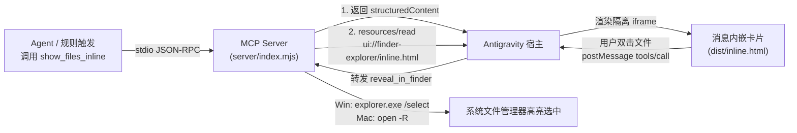

# Finder 浏览器 (`finder-explorer`) — Windows / 跨平台适配版

> [!NOTE]
> **致谢与来源声明**：本项目 Fork 并参考自原作者项目 **[jinxingtaire/finder-explorer](https://github.com/jinxingtaire/finder-explorer)**（MIT License）。在保留原项目核心架构、MCP App 协议实现与 macOS 访达支持的基础上，补充了 **Windows 资源管理器（`explorer.exe /select,`）** 及跨平台路径/UI 适配。

一个零外部依赖的 **Antigravity MCP App 插件**，让你可以在 Antigravity 的**聊天消息流**和**侧边栏**中直接双击文件，调用系统文件管理器（**Windows 资源管理器** / **macOS 访达** / **Linux 默认文件管理器**）弹出并高亮定位到具体文件。

---

## 一、它解决了什么问题？

使用 Antigravity（反重力）时，常见 4 个文件定位痛点：

1. **聊天消息里的文件胶囊双击没用**：Antigravity 对话气泡里的 `file://` 胶囊由客户端原生渲染，双击只会触发选中复制或应用内预览，无法直接弹出系统文件管理器，且插件接口不允许覆盖原生消息文本的点击事件。
2. **产出目录（`.gemini`）隐藏或层级深**：Antigravity 的 Artifact / 对话产物默认存放在 `~/.gemini/antigravity/brain/<会话ID>/`（Windows 下为 `%USERPROFILE%\.gemini\antigravity\brain\<会话ID>\`），手动定位非常麻烦。
3. **跨平台路径与中文/空格路径不便**：`.md` 等文档双击常提示缺少默认应用，或者带中文/空格的 `file:///` URI 与盘符路径容易出错。
4. **缺少一站式“看产出 + 定位文件”入口**：需要在终端和文件管理器之间反复复制路径执行定位命令。

**本插件的解法**：
* 用 **MCP App 内嵌卡片（`show_files_inline`）** 把交互式文件列表直接放进对话消息流；
* 用 **MCP App 侧边栏浏览器（`open_finder_browser`）** 提供工作区、近期项目与 `~/.gemini/antigravity/brain` 的统一浏览视图；
* 在卡片/面板内**双击任意文件**，由后端 MCP Server 安全执行系统定位命令：
  * **Windows**：`explorer.exe /select,"<path>"`（使用 `spawnDetached` + `windowsVerbatimArguments: true` 免疫空格、中文路径与 `explorer.exe` 非零退出码误报）；
  * **macOS**：`execFile("open", ["-R", targetPath])`；
  * **Linux**：`xdg-open` 打开文件所在目录。

---

## 二、Windows / 跨平台适配要点

相比原版（仅支持 macOS），本分支主要补充了以下适配：

1. **通用 Node.js 启动**：`mcp_config.json` 改为直接由 `node` 启动 `server/index.mjs`，Windows 无需依赖 `bash`。
2. **Windows 路径与盘符修复**：
   - 使用 Node.js 原生 `fileURLToPath` 正确解析 Windows `file:///C:/...` URI，兼容 `~\` 路径展开；
   - 修复 `buildBreadcrumbs` 在 Windows 盘符根目录（如 `C:\`）下 `path.basename` 为空导致面包屑缺失的问题；
   - 使用 `path.parse(cwd).root` 替代硬编码 `'/'` 根路径判断。
3. **跨平台文件定位与打开**：
   - `reveal_in_finder` 与 `open_in_system` 均兼容 `win32` / `darwin` / `linux`；
   - `structuredContent` 透传 `platform` 字段，前端 UI（`dist/app.html`、`dist/inline.html`）自动按当前系统切换提示与按钮文案（Windows 显示 **“资源管理器 / 定位”**，macOS 显示 **“访达”**），并修复 `split(/[\\/]/`)` 兼容反斜杠路径提取文件名。

---

## 三、卡片的工作原理

整个卡片基于 **MCP（Model Context Protocol）+ MCP Apps（SEP-1865）** 协议运行，分为三层：



---

## 四、它是如何自动生效的？

1. **插件自动发现**：
   Antigravity 会自动扫描 `~/.gemini/config/plugins/<name>/` 下的 `plugin.json` 与 `mcp_config.json`，无需额外注册命令即可启动 `finder-explorer_finder` MCP 服务。
2. **规则驱动自动出卡（`Always On`）**：
   * **全局插件规则**：[rules/AGENTS.md](rules/AGENTS.md) 随插件启用自动生效；
   * **项目级规则模板**：[examples/.agents/rules/finder-inline-card.md](examples/.agents/rules/finder-inline-card.md) 可放入任意项目的 `.agents/rules/`（`trigger: always_on`），即使新开干净上下文窗口，Agent 也会在产出交付物后自动调用 `show_files_inline`。
3. **跨会话持久化**：
   通过 `${PLUGIN_DATA}` 参数将用户的收藏目录、隐藏文件开关与双击文件夹偏好保存到 `state.json`。

---

## 五、目录结构

```text
finder-explorer/
├── .gitattributes                      # 跨平台换行符规范（统一 LF）
├── plugin.json                         # 插件清单（名称、描述、图标、推荐提示词）
├── mcp_config.json                     # MCP 服务注册配置（node 直接启动 server/index.mjs）
├── bin/finder-server                   # 原 POSIX 启动脚本（保留兼容）
├── server/index.mjs                    # 零依赖跨平台 Node.js MCP Server（tools + resources）
├── dist/
│   ├── inline.html                     # 消息流内嵌文件卡片（单文件自包含）
│   └── app.html                        # 侧边栏/全局文件浏览器（单文件自包含）
├── rules/AGENTS.md                     # 插件内置全局规则：产出后自动展示卡片
├── assets/logo.svg                     # 插件图标
└── examples/.agents/rules/
    └── finder-inline-card.md           # 可复用的工作区 .agents 规则模板
```

---

## 六、安装与使用（在另一台电脑部署）

### 前置要求
* **Node.js**（建议 v18+，Windows / macOS / Linux 均适用）
* **Git**（或直接下载仓库/Release `.zip` 压缩包）

### 方式 A：Windows 一键安装（PowerShell）

```powershell
git clone https://github.com/cai4415/finder-explorer.git "$env:USERPROFILE\.gemini\config\plugins\finder-explorer"
```

### 方式 B：macOS / Linux 一键安装（Bash）

```bash
git clone https://github.com/cai4415/finder-explorer.git ~/.gemini/config/plugins/finder-explorer
chmod +x ~/.gemini/config/plugins/finder-explorer/bin/finder-server
```

### 方式 C：离线压缩包安装
从 GitHub 仓库的 **Releases / Tags** 下载源码 `.zip` 压缩包，解压后重命名为 `finder-explorer` 并放到：
* Windows：`%USERPROFILE%\.gemini\config\plugins\finder-explorer`
* macOS / Linux：`~/.gemini/config/plugins/finder-explorer`

安装完成后重启或新开 Antigravity 会话，Antigravity 会自动发现并加载 `finder-explorer`。后续如需同步更新，在插件目录执行 `git pull` 即可。

### 使用方式
* **消息流内嵌卡片**：正常让 Antigravity 生成文档、脚本、报告或产物，回复末尾会自动附上文件卡片，**双击任意文件**即可弹出系统文件管理器定位；也可以直接让它“用卡片展示当前目录文件”。
* **侧边栏文件浏览器**：在右侧辅助栏点击 `+` → **Finder 浏览器**（或左侧边栏 **Finder 浏览器**），可切换 **目录浏览** 与 **最近产出**（自动扫描 `~/.gemini/antigravity/brain`），支持路径直达（`Cmd/Ctrl + L`）、收藏目录与关键字过滤。

---

## 七、参考致谢与开源协议

* **原作者仓库**：[jinxingtaire/finder-explorer](https://github.com/jinxingtaire/finder-explorer) — 感谢原作者设计并开源这套优雅的零依赖 Antigravity MCP App 文件浏览器与消息内嵌卡片机制。
* **License**：[MIT](LICENSE)（保留原作者版权声明 `Copyright (c) 2026 jinxingtaire`）。
